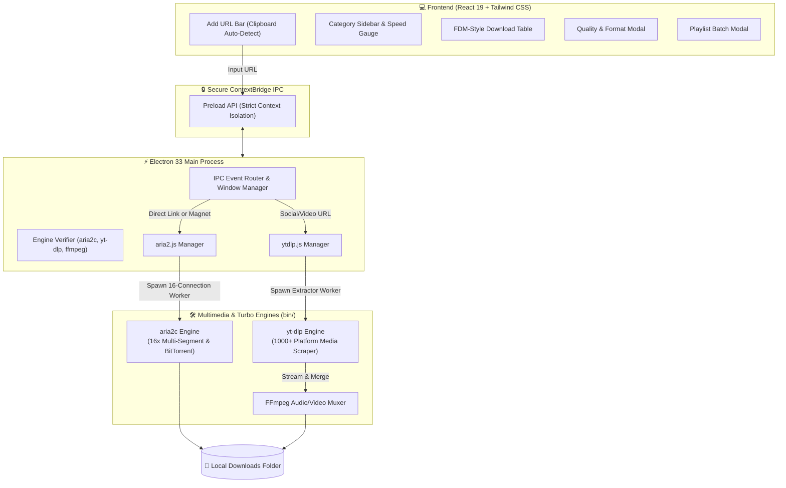

<div align="center">

# ⚡ Uni Downloader

### FDM / IDM-Style Universal Desktop Download Manager with 16x Turbo Acceleration, Torrents & 1000+ Video Platforms

[](LICENSE)
[](package.json)
[](https://aria2.github.io/)
[](https://github.com/yt-dlp/yt-dlp)
[](https://www.electronjs.org/)
[](https://react.dev/)
[](https://tailwindcss.com/)

<p align="center">
  <b>Uni Downloader (v2.0)</b> is a modern, high-performance desktop download manager built as an open-source, ad-free alternative to IDM and Free Download Manager. Featuring a dual-engine architecture: <b>aria2c</b> for 16-connection multi-segment direct downloads and BitTorrent/Magnets, alongside <b>yt-dlp + FFmpeg</b> for extracting up to <b>4K 60fps video</b> and <b>320kbps MP3 audio</b> from 1,000+ social and streaming platforms.
</p>

[Key Features](#-key-features) •
[Dual-Engine Architecture](#-dual-engine-architecture) •
[Supported Formats & Platforms](#-supported-platforms--formats) •
[Quick Start](#-quick-start-windows) •
[Security Hardening](#-security--privacy) •
[Roadmap](#-roadmap)

---

</div>

## 🌟 Overview

Most internet downloaders fall into two broken extremes: traditional download managers like IDM/FDM that lack seamless social media video extraction, or web-based video downloaders flooded with intrusive ads, telemetry, and artificial speed throttles.

**Uni Downloader** unifies both worlds into a single, sleek desktop application:

- **16x Multi-Segment Turbo Acceleration**: Splits direct files into up to 16 simultaneous chunks via `aria2c` to maximize your ISP bandwidth.
- **BitTorrent & Magnet Link Ready**: Download torrents and magnet links natively without needing separate bloated clients.
- **Universal Social Video Extractor**: Auto-detects and downloads videos, reels, shorts, and playlists from YouTube, Instagram, TikTok, Twitter/X, and 1,000+ sites.
- **FDM/IDM-Style Tabular Dashboard**: Organize downloads with sidebar categories (Active, Completed, Paused, Error, Trash, Videos, Audios, Torrents), live transfer speeds, and ETA meters.
- **100% Free & Open Source**: No popups, no subscriptions, and zero tracking.

---

## ✨ Key Features

### 1. 🚀 16x Multi-Connection Direct File Engine (aria2c)
- **Multi-Segment Splitting**: Splits large files (ISOs, software installers, archives, game patches) across 16 parallel connections.
- **Resume Capability**: Seamlessly pause and resume interrupted direct downloads without losing progress.
- **Connection Optimization**: Configurable minimum split size and aggressive chunk fetching.

### 2. 🧲 Native BitTorrent & Magnet Link Support
- Directly paste any `magnet:?xt=...` URI or add `.torrent` files.
- Real-time peer connections, seeders, download speed, and piece verification handled natively by `aria2c`.

### 3. 🎥 Universal Media & Video Extractor (yt-dlp + FFmpeg)
- **Video Qualities**: `4K Ultra HD (2160p)`, `2K Quad HD (1440p)`, `1080p Full HD`, `720p HD`, `480p`, and `360p`.
- **Audio Extraction**: `MP3 (320kbps Studio, 256kbps, 192kbps, 128kbps)`, `M4A (AAC)`, `FLAC (Lossless)`, and `WAV`.
- **Containers**: MP4 (maximum compatibility), MKV, and WebM.
- **Full Playlist Batch Downloader**: Paste any playlist URL to preview all items, select individual tracks or "Select All", and batch-queue with concurrency management.

### 4. 📊 IDM-Style Ledger & Dashboard
- **Sidebar Organization**:
  - Task States: `All`, `Active`, `Completed`, `Paused`, `Error`, `Trash`.
  - Type Filters: `Video`, `Audio`, `Direct / Docs`, `Torrents`.
  - Live Global Speed Gauge (e.g. `28.4 MB/s`).
- **Interactive Data Table**:
  - Live status pills (`Downloading`, `Merging`, `16x Turbo`, `Seeding`, `Completed`).
  - Progress bar with percentage and byte counter (`1.2 GB / 2.4 GB`).
  - Real-time speed and dynamic ETA countdown.
  - One-click actions: Open completed media, reveal file in Windows Explorer, pause, resume, or remove.

### 5. 🎨 Polished Modern Desktop UI
- Custom frameless titlebar with Minimize, Maximize/Restore, and Close actions.
- Real-time **Engine Status Pill** showing readiness of `yt-dlp`, `FFmpeg`, and `aria2c`.
- Keyboard navigation and smart clipboard auto-detection.

---

## 🏗️ Dual-Engine Architecture



---

## 🌐 Supported Platforms & Formats

| Category | Supported Services | Details |
| :--- | :--- | :--- |
| **Direct Web Downloads** | HTTP, HTTPS, FTP, SFTP | Up to 16 simultaneous segmented chunk connections via `aria2c` |
| **P2P & Torrents** | Magnet Links (`magnet:?xt=...`), `.torrent` | DHT, PEX, Local Peer Discovery, and multi-tracker support |
| **YouTube** | Videos, Shorts, Playlists, Channels | Up to 4K/8K 60fps HDR, 320kbps MP3 audio extraction |
| **Instagram** | Reels, Video Posts, Stories, Carousels | High-resolution video and original audio streams |
| **TikTok** | Video posts and clips | Clean watermark-free high-definition downloads |
| **Twitter / X** | Videos, GIFs, clips | High-bitrate video stream extraction |
| **Snapchat** | Spotlights, public stories | MP4 video captures |
| **Facebook & Reddit** | Public reels, watch streams, posts | Combined audio/video multiplexing |
| **Dailymotion & Vimeo** | Full HD and 4K source videos | Native stream merging |
| **Twitch & Kick** | Stream clips, VODs | Direct HLS and MP4 stream captures |
| **1000+ More Platforms** | Universal scraper powered by yt-dlp | Any platform supported by yt-dlp |

---

## 🛠️ Technology Stack

| Component | Technology | Version | Description |
| :--- | :--- | :--- | :--- |
| **Desktop Shell** | Electron | v33.2+ | Frameless native window management and OS integration |
| **Frontend UI** | React | v19.0 | Declarative component tree with fast state rendering |
| **Build Tool** | Vite | v6.0 | Lightning-fast development server and optimized bundler |
| **Styling** | Tailwind CSS | v3.4 | Modern utility-first responsive design system |
| **Icons** | Lucide React | v1.16+ | Clean, accessible SVG iconography |
| **Turbo Engine** | aria2c | v1.37+ | 16-connection multi-segment direct and BitTorrent downloader |
| **Media Extractor**| yt-dlp | Latest | Advanced media extractor for 1000+ web platforms |
| **Media Processing**| FFmpeg & FFprobe | v6.0+ | Audio/video multiplexing and format conversion |
| **Automation** | Windows Batch Scripts | - | One-click environment check, engine installer, and launcher |

---

## 🚀 Quick Start (Windows)

### 1. Automated Setup (First Time)
Double-click `setup.bat` or run in terminal:
```cmd
setup.bat
```
This automated script will:
1. Verify that **Node.js** is installed.
2. Verify or auto-fetch **yt-dlp** standalone binary into `bin/`.
3. Verify or auto-fetch **FFmpeg** multimedia tools into `bin/`.
4. Verify or auto-download **aria2c** (16x Turbo engine) into `bin/`.
5. Install all NPM packages.
6. Compile the production UI build into `dist/`.

---

### 2. Launch Uni Downloader
Double-click `run.bat` or run:
```cmd
run.bat
```
Uni Downloader opens instantly, ready to handle direct files, torrents, or videos!

---

### 3. Developer Mode (Hot-Reloading)
To modify source code with live hot reload:
```cmd
run.bat --dev
# or
npm run electron:dev
```

---

## 📂 Project Structure

```text
uni_downloader/
├── setup.bat                 # Automated installer for dependencies & engines
├── run.bat                   # Desktop launcher (production & dev)
├── .gitignore                # Excludes node_modules, dist, downloads, and binaries
├── CONTRIBUTING.md           # Guidelines for open source contributors
├── LICENSE                   # MIT Open Source License
├── README.md                 # Complete documentation
├── package.json              # Project metadata & npm dependencies (v2.0.0)
├── vite.config.js            # Vite build configuration
├── tailwind.config.js        # Tailwind styling configuration
├── electron/
│   ├── main.js               # Electron main process, lifecycle & IPC router
│   ├── preload.cjs           # Secure contextBridge interface
│   ├── binaries.js           # Engine status detector & auto-downloader
│   ├── aria2.js              # 16x multi-segment direct & torrent engine
│   └── ytdlp.js              # yt-dlp media argument builder & stream processor
└── src/
    ├── main.jsx              # React root entry
    ├── App.jsx               # Master application controller & concurrency queue
    ├── index.css             # Base stylesheet & font styling
    └── components/
        ├── TitleBar.jsx          # Frameless titlebar with 16x Turbo status
        ├── Sidebar.jsx           # Category navigation & total speed gauge
        ├── AddUrlBar.jsx         # Universal URL input with clipboard auto-detect
        ├── DownloadTable.jsx     # FDM/IDM-style tabular download ledger
        ├── MediaModal.jsx        # Resolution & audio quality picker modal
        ├── PlaylistModal.jsx     # Playlist batch selector modal
        └── SettingsModal.jsx     # Engine configurations & folder preferences
```

---

## 🛡️ Security & Privacy

Uni Downloader is engineered with strict adherence to modern desktop security standards:

- **Chromium Sandbox Active**: Renderer operates within Chromium's secure process isolation (`sandbox: true`).
- **Context Isolation Enforced**: Direct Node.js access is disabled in the web view (`contextIsolation: true`, `nodeIntegration: false`).
- **Strict Input Sanitization**: Prevents CLI option injection by rejecting leading dashes (`-`) and validating standard URI protocols (`http:`, `https:`, `magnet:`).
- **Whitelisted File Openings**: Shell execution is strictly constrained to recognized media and archive formats.
- **No Cloud Intermediaries**: All downloads stream directly from origin servers or P2P swarms straight to your hard drive.

---

## 🗺️ Roadmap

- [x] 16x Multi-segment direct file acceleration (`aria2c`)
- [x] BitTorrent and Magnet link downloading
- [x] 1,000+ social and video platforms support (`yt-dlp` + `FFmpeg`)
- [x] FDM/IDM-style tabular dashboard with categories & search
- [x] Concurrency queue management with live speed & ETA metrics
- [ ] 💬 Subtitle and closed caption downloader (.srt, .vtt)
- [ ] 🌙 Dark Mode / High Contrast theme toggle
- [ ] ⚡ Bandwidth throttling / speed limit scheduler
- [ ] 🧩 Chrome & Firefox companion extension for one-click browser integration
- [ ] 📦 Linux (.AppImage, .deb) and macOS (.dmg) cross-platform builds

---

## 🤝 Contributing

Contributions, feature ideas, and pull requests are welcomed!  
Please see [CONTRIBUTING.md](CONTRIBUTING.md) for details.

---

## 📜 License

This project is licensed under the **MIT License** - see the [LICENSE](LICENSE) file for details.

---

## 👨‍💻 Author

**Dhruvil Panchal**
- GitHub: [@dhruvil-114](https://github.com/dhruvil-114)

---

<div align="center">
  <sub>Built with ❤️ for fast, private, ad-free universal downloading.</sub>
</div>
