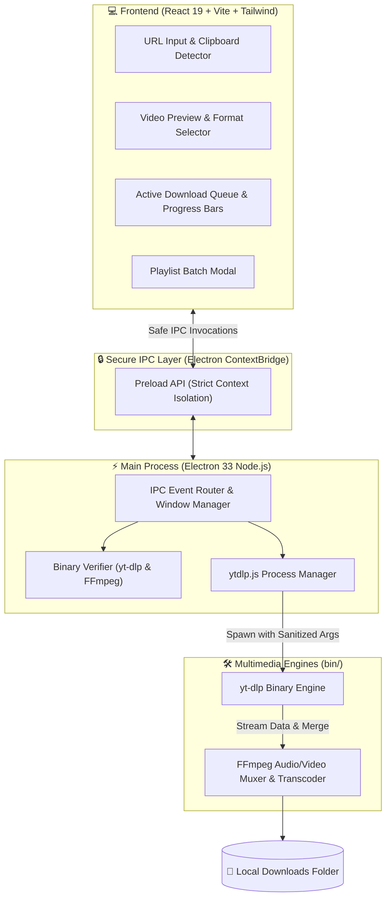

<div align="center">

# 📥 StreamVault

### Universal Desktop Media & Video Downloader for YouTube, Instagram, TikTok & 1000+ Platforms

[](LICENSE)
[](https://www.electronjs.org/)
[](https://react.dev/)
[](https://vitejs.dev/)
[](https://tailwindcss.com/)
[](https://github.com/yt-dlp/yt-dlp)
[](https://ffmpeg.org/)

<p align="center">
  <b>StreamVault</b> is an open-source, desktop application designed for fast, clean, and ad-free media downloading. Powered by <b>Electron</b>, <b>React 19</b>, <b>yt-dlp</b>, and <b>FFmpeg</b>, it delivers up to <b>4K 60fps video</b> and <b>320kbps MP3 audio</b> with live speed metrics, playlist batch processing, and security hardening.
</p>

[Key Features](#-key-features) •
[Supported Platforms](#-supported-platforms) •
[Architecture](#-system-architecture) •
[Quick Start](#-quick-start-windows) •
[Security Hardening](#-security--privacy) •
[Roadmap](#-roadmap)

---

</div>

## 🌟 Overview

Most online video download sites are filled with deceptive ads, fake download buttons, slow transfer caps, and privacy concerns. **StreamVault** replaces fragile web downloaders with a secure, high-performance desktop application:

- **Full Bandwidth**: Uses multi-stream downloading via `yt-dlp` and `FFmpeg` to maximize your connection speed.
- **100% Ad-Free & Private**: Zero tracking, zero telemetry, and zero third-party cloud intermediaries.
- **Universal Compatibility**: Works across 1,000+ social networks, video hosting sites, and media platforms.
- **Crisp High-Contrast UI**: Clean light theme with responsive masonry controls, framed in a frameless custom titlebar.

---

## 🌐 Supported Platforms

StreamVault automatically detects URLs and extracts highest-quality media from:

| Platform | Capabilities |
| :--- | :--- |
| **YouTube** | 4K/8K HDR, 60fps, Shorts, Full Playlists, Channels, 320k MP3 Audio |
| **Instagram** | Reels, Video Posts, Stories, Carousels, Audio tracks |
| **TikTok** | Watermark-free high-definition video downloads |
| **Twitter / X** | Video clips, GIFs, and media threads |
| **Snapchat** | Spotlights and public stories |
| **Facebook** | Public reels, video posts, and watch streams |
| **Reddit** | Video + audio streams automatically merged |
| **Dailymotion & Vimeo** | Full HD and 4K source video streams |
| **Twitch & Kick** | Stream clips and VODs |
| **Pinterest & SoundCloud** | Video pins and high-bitrate audio streams |
| **1000+ Web Platforms** | Universal extractor engine powered by yt-dlp |

---

## ✨ Key Features

### 1. 🎥 Granular Video & Audio Quality Selection
- **Video Resolutions**: `4K Ultra HD (2160p)`, `2K Quad HD (1440p)`, `1080p Full HD`, `720p HD`, `480p`, and `360p`.
- **Video Containers**: MP4 (universal compatibility), MKV, and WebM.
- **Audio Extraction**:
  - `MP3`: 320kbps (Studio Master), 256kbps, 192kbps, and 128kbps.
  - `M4A (AAC)`: Native Apple lossless streaming audio.
  - `FLAC & WAV`: Uncompressed bit-for-bit lossless audio.

### 2. 📑 Smart Playlist & Batch Downloader
- Detects playlist URLs automatically.
- Interactive modal with thumbnail previews, duration, channel name, and track numbers.
- **One-Click Select All**: Queue entire albums, series, or video collections in seconds.

### 3. ⚡ Multi-Task Download Queue & Live Metrics
- Concurrency queue manager that prevents system slowdowns by limiting active downloads.
- Real-time updates:
  - Exact progress percentage (`0% - 100%`)
  - Live download speed (e.g. `14.8 MB/s`)
  - Estimated time remaining (`ETA: 00:45`)
  - Final merged file size
- Interactive actions: Open completed media directly, reveal containing folder in Windows Explorer, or cancel in-progress tasks.

### 4. 🎨 Modern Desktop Experience
- **Custom Frameless Titlebar**: Native look with smooth Minimize, Maximize, and Close actions.
- **Quick Paste Detection**: Automatically detects YouTube, Instagram, or media links directly from the clipboard.
- **Configurable Settings**: Choose custom default download folders and default quality preferences.

---

## 🏗️ System Architecture



---

## 🛠️ Technology Stack

| Layer | Technology | Version | Purpose |
| :--- | :--- | :--- | :--- |
| **Desktop Shell** | Electron | v33.2+ | Frameless native window management and secure OS integration |
| **Frontend UI** | React | v19.0 | Fast, declarative reactive component tree |
| **Build Tool** | Vite | v6.0 | Instant HMR development server and optimized build bundling |
| **Styling** | Tailwind CSS | v3.4 | Clean light-mode design system with utility classes |
| **Icons** | Lucide React | v1.16+ | Crisp, scalable SVG iconography |
| **Download Engine** | yt-dlp | Latest | Robust video extractor and protocol handler |
| **Media Processing**| FFmpeg & FFprobe | v6.0+ | Video/audio muxing, re-encoding, and metadata tagging |
| **Automation** | Windows Batch Scripts | - | Automated dependency check, binary download, and build runner |

---

## 🚀 Quick Start (Windows)

### 1. Automated Setup (First Time)
Double-click `setup.bat` or run in terminal:
```cmd
setup.bat
```
This automated script will:
1. Verify that **Node.js** is installed.
2. Verify or download **yt-dlp** standalone binary into `bin/`.
3. Verify or fetch **FFmpeg** multimedia tools into `bin/`.
4. Install all NPM packages.
5. Compile the production UI build into `dist/`.

---

### 2. Launch StreamVault
Double-click `run.bat` or run:
```cmd
run.bat
```
The desktop application opens instantly, ready to download!

---

### 3. Developer Mode (Hot-Reloading)
To modify source code with live hot reload:
```cmd
run.bat --dev
# or
npm run electron:dev
```

---

## 📂 Project Structure

```text
downloader/
├── setup.bat                 # Automated one-click installer for dependencies & binaries
├── run.bat                   # One-click desktop launcher (production & dev)
├── .gitignore                # Excludes node_modules, dist, downloads, and binaries
├── CONTRIBUTING.md           # Guidelines for open source contributors
├── LICENSE                   # MIT Open Source License
├── README.md                 # Complete documentation
├── package.json              # Project metadata & npm dependencies
├── vite.config.js            # Vite build configuration
├── tailwind.config.js        # Tailwind design system configuration
├── electron/
│   ├── main.js               # Electron main process, lifecycle & IPC handlers
│   ├── preload.cjs           # Secure contextBridge interface
│   ├── binaries.js           # Binaries status detector & downloader
│   └── ytdlp.js              # yt-dlp argument builder, progress parser & process spawn
└── src/
    ├── main.jsx              # React application root
    ├── App.jsx               # Master application controller & concurrency runner
    ├── index.css             # Base stylesheet & font configurations
    └── components/
        ├── TitleBar.jsx          # Custom sleek frameless titlebar
        ├── UrlInput.jsx          # URL bar with clipboard auto-detection
        ├── VideoPreview.jsx      # Thumbnail, duration, views & channel info
        ├── FormatSelector.jsx    # Quality chips (4K, 1080p, MP3 bitrates)
        ├── DownloadItem.jsx      # Progress bar, speed metrics & open file actions
        ├── PlaylistModal.jsx     # Interactive playlist multi-select dialog
        └── SettingsModal.jsx     # Download folder & concurrency preferences
```

---

## 🛡️ Security & Privacy

StreamVault is engineered following modern Electron security best practices:

- **Chromium Sandbox Enabled**: The web renderer operates inside Chromium's restrictive sandbox (`sandbox: true`).
- **Context Isolation**: Direct Node.js access is prohibited in the renderer (`contextIsolation: true`, `nodeIntegration: false`).
- **Command Injection Prevention**: All input URLs are strictly sanitized before spawning child processes (rejecting leading dashes `-` and verifying valid HTTP/HTTPS schemes).
- **Safe File Execution**: Only whitelisted safe media extensions (`.mp4`, `.m4a`, `.mp3`, `.mkv`, `.webm`) can be opened via the shell handler.
- **Repository Cleanliness**: Large binary files (`bin/`) and user media files (`downloads/`) are excluded from Git to prevent repository bloat and ensure fast cloning.

---

## 🗺️ Roadmap

- [x] Multi-platform support (YouTube, Instagram, TikTok, Twitter, Facebook)
- [x] Full video qualities up to 4K 60fps & MP3 up to 320kbps
- [x] Playlist batch downloading with individual track selection
- [x] Concurrency download queue with speed and ETA calculations
- [x] Custom frameless desktop UI with light theme
- [ ] 💬 Subtitle & Closed Caption extractor (.srt, .vtt)
- [ ] 🌙 Dark Mode / High Contrast theme toggle
- [ ] ⚡ Download speed limiter / bandwidth throttling
- [ ] 🧩 Browser companion extension for one-click desktop downloads
- [ ] 📦 Cross-platform packaging for Linux (.AppImage, .deb) and macOS (.dmg)

---

## 🤝 Contributing

Contributions, bug reports, and pull requests are welcomed!  
Please see [CONTRIBUTING.md](CONTRIBUTING.md) to get started.

---

## 📜 License

This project is licensed under the **MIT License** - see the [LICENSE](LICENSE) file for details.

---

## 👨‍💻 Author

**Dhruvil Panchal**
- GitHub: [@dhruvil-114](https://github.com/dhruvil-114)

---

<div align="center">
  <sub>Built with ❤️ for simple, ad-free, high-speed universal media downloading.</sub>
</div>
